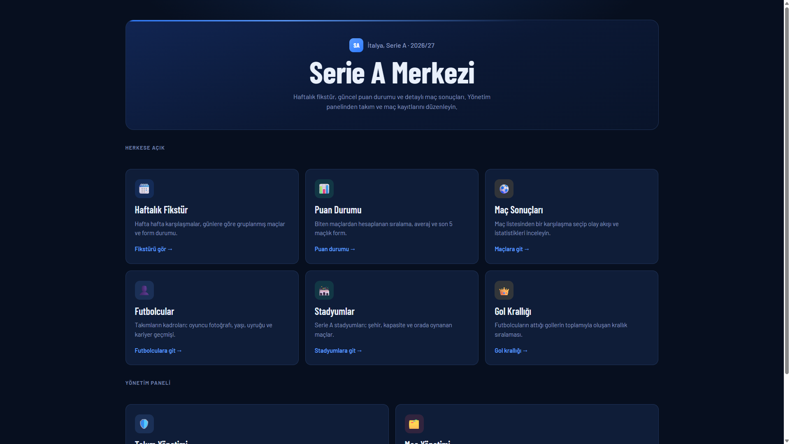
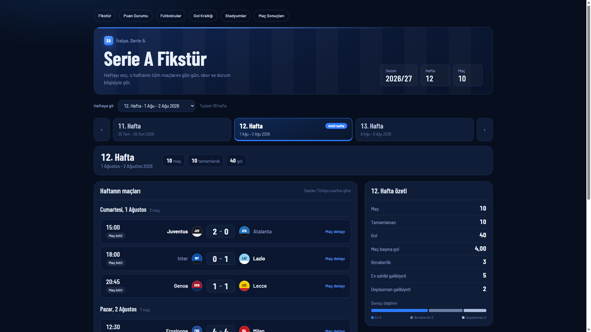
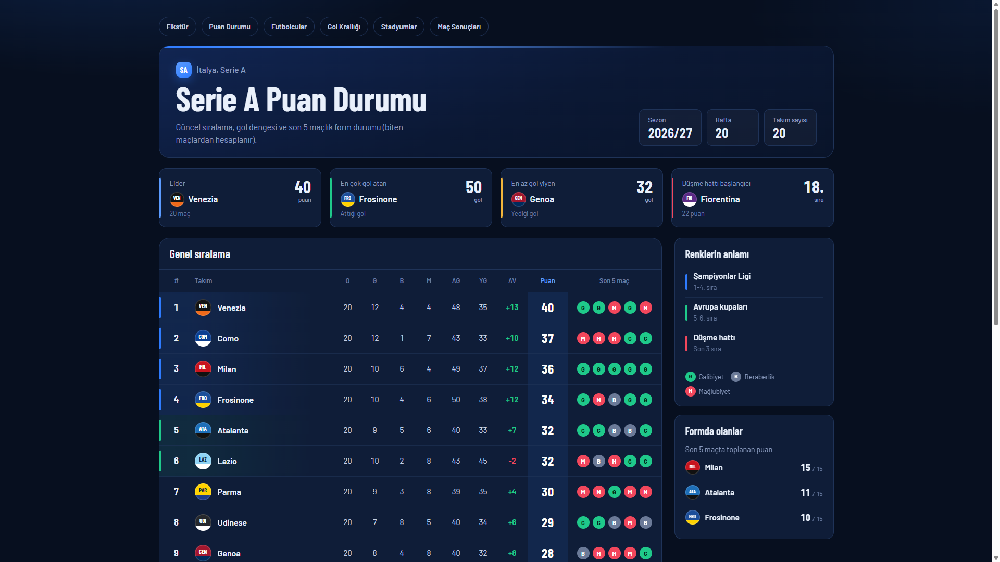
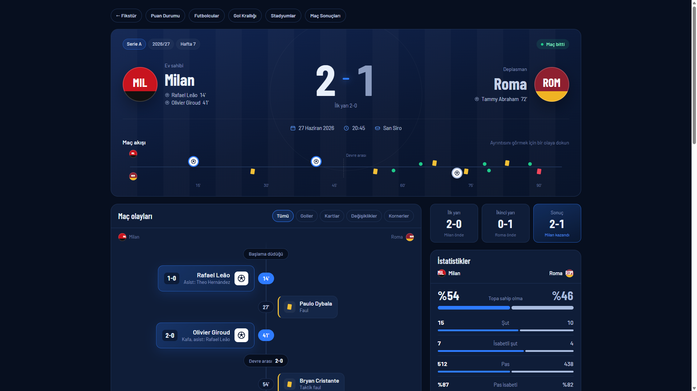
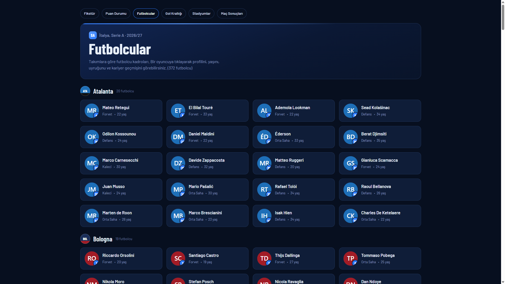
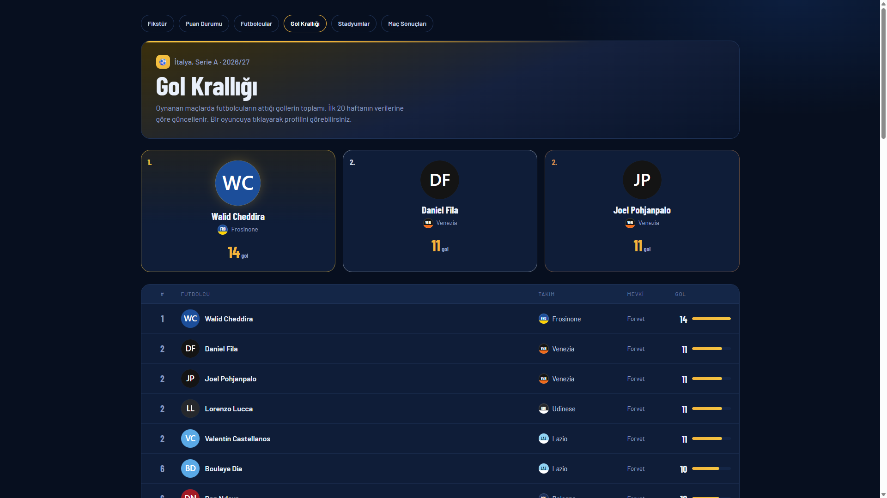
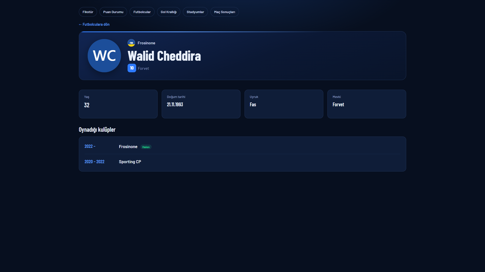
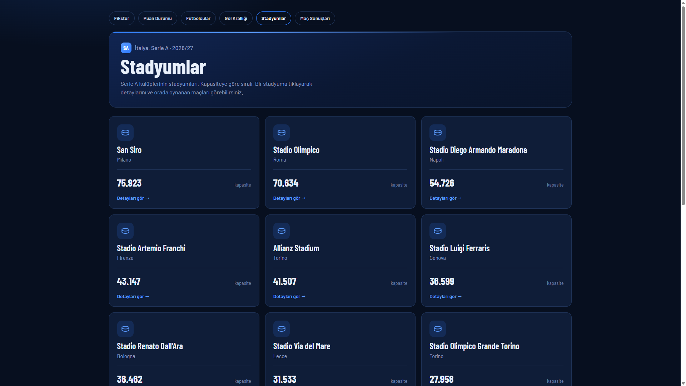
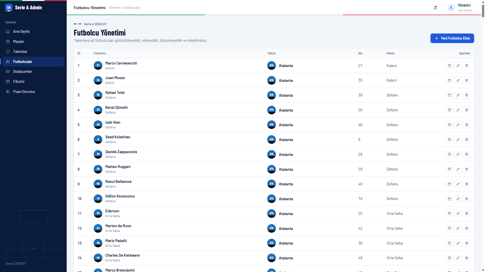

# ⚽ Serie A Merkezi - Futbol Lig & Maç Yönetim Platformu

Modern bir **ASP.NET Core 8.0 MVC** uygulaması ile inşa edilmiş, tam işlevli bir **futbol ligi yönetim ve istatistik platformu**. İtalya **Serie A** ligini temel alır; **Web API + Web UI** olmak üzere iki katmanlı bir mimariye sahiptir. **Entity Framework Core**, **SQL Server**, **AutoMapper** ve **HttpClient** tabanlı servis tüketimi ile geliştirilmiştir. Tüm arayüz Türkçedir.

---

## 📋 Proje Özellikleri

### 🎯 Ana Özellikler

- **🗓️ 38 Haftalık Fikstür** - Çift devreli lig usulü (double round-robin); hafta seçici, gün gün gruplanmış maçlar, skor ve durum (Oynanmadı / Devam ediyor / Bitti)
- **📊 Puan Durumu** - Biten maçlardan canlı hesaplanan sıralama; galibiyet/beraberlik/mağlubiyet, averaj, atılan/yenen gol, son 5 maçlık **form** durumu ve Avrupa kupası / düşme hattı renklendirmesi
- **⚽ Detaylı Maç Sonucu** - Olay akışı (gol, asist, sarı/kırmızı kart, oyuncu değişikliği, korner), devre devre skor ve zengin maç istatistikleri (topla oynama, şut, isabetli şut, pas, pas isabeti, faul, ofsayt)
- **👤 Futbolcular** - Tüm Serie A kadroları (**372 futbolcu**); takıma göre gruplanmış kartlar, oyuncu fotoğrafı, forma numarası, mevki, yaş
- **🧑‍💼 Futbolcu Profili** - Fotoğraf, yaş, doğum tarihi, uyruk, mevki ve **oynadığı kulüpler** (kariyer geçmişi, "Halen" rozeti)
- **👑 Gol Krallığı** - Futbolcuların attığı gollerin toplamıyla oluşan krallık sıralaması; podyum (ilk 3) + tam tablo, beraberlikte aynı sıra numarası
- **🏟️ Stadyumlar** - Tüm Serie A stadyumları (**18 stadyum**); şehir, kapasite ve o stadyumda oynanan maçlar
- **🔗 Gerçek İlişkiler** - Maç olaylarındaki futbolcular ve stadyumlar gerçek **FK** ilişkileriyle profil sayfalarına bağlanır (tıklanabilir)
- **🛠️ Yönetim Paneli (Admin)** - Takım, Maç, Futbolcu, Stadyum ve Kariyer kayıtları için eksiksiz **CRUD**; ayrı koyu temalı admin arayüzü (sidebar, topbar)

### 🔧 Teknoloji Stack

| Teknoloji | Versiyon | Açıklama |
|-----------|----------|----------|
| **.NET** | 8.0 | Microsoft .NET framework |
| **ASP.NET Core MVC / Web API** | 8.0 | Web uygulama & REST API çatısı |
| **Entity Framework Core** | 8.0.31 | ORM (Code-First + Migrations) |
| **SQL Server** | Express | İlişkisel veritabanı |
| **AutoMapper** | 13.0.1 | Nesne eşleme (Entity ↔ DTO) |
| **Newtonsoft.Json** | 13.0.3 | API yanıtlarının deserialize edilmesi |
| **Swashbuckle (Swagger)** | 6.6.2 | API dokümantasyonu / test arayüzü |
| **Bootstrap** | 5.3 | Responsive UI framework |

---

## 🏗️ Mimari

Proje iki ayrı ASP.NET Core uygulamasından oluşur:

```
┌─────────────────────────┐        HTTP (HttpClient + JSON)        ┌─────────────────────────┐
│   SoccerProject.WebUI    │  ───────────────────────────────────▶ │   SoccerProject.WebAPI   │
│   (MVC - ön yüz + admin) │                                        │   (REST API)             │
│   https://localhost:7108 │  ◀─────────────────────────────────── │   https://localhost:7071 │
└─────────────────────────┘              JSON yanıtı               └───────────┬─────────────┘
                                                                                │ EF Core
                                                                     ┌──────────▼──────────┐
                                                                     │   SQL Server        │
                                                                     │   SoccerProjectDb   │
                                                                     └─────────────────────┘
```

- **WebAPI**: Entity + DTO + AutoMapper + EF Core ile veritabanını yönetir, REST uç noktaları sunar.
- **WebUI**: `HttpClient` ile API'yi tüketir; herkese açık (public) sayfalar + yönetim paneli (admin) içerir. Veri tutmaz, tamamen API'den beslenir.

---

## 🗄️ Veritabanı Şeması

Proje **SQL Server** üzerinde **EF Core Code-First** yaklaşımı ve **Migration** kullanır.

```
📊 Veritabanı: SoccerProjectDb (SQL Server)

├── Teams                 → Takımlar (20 Serie A kulübü)
│
├── Stadiums              → Stadyumlar (ad, şehir, kapasite)
│
├── Players               → Futbolcular (ad, forma no, mevki, foto, doğum tarihi, uyruk)
│   └── → FK: TeamId (Team)
│
├── PlayerCareers         → Oyuncu kariyer geçmişi (kulüp, başlangıç/bitiş yılı)
│   └── → FK: PlayerId (Player, Cascade)
│
├── Fixtures              → Maçlar (hafta, tarih, skor, devre skoru, durum)
│   ├── → FK: HomeTeamId / AwayTeamId (Team)
│   └── → FK: StadiumId (Stadium, opsiyonel)
│
├── MatchStatics          → Maç istatistikleri (topla oynama, şut, pas, kart...)
│   └── → FK: FixtureId (Fixture)
│
└── MatchEvents           → Maç olayları (gol, kart, değişiklik, korner + dakika)
    ├── → FK: FixtureId (Fixture)
    └── → FK: PlayerId (Player, opsiyonel)
```

> **İlişki notu:** `MatchEvents.PlayerId` ve `Fixtures.StadiumId` sayesinde maç detayındaki futbolcu ve stadyum isimleri gerçek kayıtlara bağlıdır; üzerine tıklanınca ilgili profil/detay sayfasına gidilir.

---

## 🚀 Başlangıç

### Gereksinimler

- [.NET 8.0 SDK](https://dotnet.microsoft.com/download)
- [SQL Server](https://www.microsoft.com/sql-server) (Express yeterli) + SSMS veya `sqlcmd`
- Visual Studio 2022 / VS Code

### Kurulum Adımları

#### 1. Depoyu Klonlayın

```bash
git clone https://github.com/cemreeryilmaz/SoccerProject.git
cd SoccerProject
```

#### 2. Veritabanı Bağlantısını Yapılandırın

`SoccerProject.WebAPI/Context/SoccerDbContext.cs` içindeki bağlantı dizesini kendi SQL Server örneğinize göre güncelleyin:

```csharp
optionsBuilder.UseSqlServer(
    "Server=CEMRE\\SQLEXPRESS;Database=SoccerProjectDb;Integrated Security=true;TrustServerCertificate=True;");
```

#### 3. API'yi Çalıştırın (veritabanını ve takımları oluşturur)

```bash
dotnet run --project SoccerProject.WebAPI --urls https://localhost:7071
```

İlk açılışta migration'lar uygulanır, veritabanı oluşturulur ve **20 Serie A takımı** otomatik eklenir (`DbInitializer`).

#### 4. Tam Örnek Veriyi Yükleyin (38 hafta + futbolcular + stadyumlar)

20 takım eklendikten sonra, hazır seed script'ini çalıştırın:

```bash
sqlcmd -S "CEMRE\SQLEXPRESS" -d SoccerProjectDb -E -C -i "SoccerProject.WebAPI/SeedData/SeriA_38Hafta_SeedData.sql" -f 65001
```

Bu script şunları yükler: **380 maç** (1–20. haftalar oynanmış), **200 maç istatistiği**, **4.800+ maç olayı**, **372 futbolcu**, **933 kariyer kaydı** ve **18 stadyum**. (Script `tools/generate_seed_sql.py` ile deterministik olarak üretilir.)

#### 5. Web Arayüzünü Çalıştırın

Ayrı bir terminalde (API açık kalsın):

```bash
dotnet run --project SoccerProject.WebUI --urls https://localhost:7108
```

Uygulama şu adreste çalışır: **https://localhost:7108** · API Swagger: **https://localhost:7071/swagger**

> **İpucu:** API ile WebUI'yi aynı anda tek komutla başlatmayın; önce API'nin ayağa kalkmasını bekleyin, sonra WebUI'yi başlatın.

---

## 🎥 Ekran Görüntüleri

### 1. Ana Sayfa


### 2. Haftalık Fikstür


### 3. Puan Durumu


### 4. Detaylı Maç Sonucu


### 5. Futbolcular


### 6. Gol Krallığı


### 7. Futbolcu Profili


### 8. Stadyumlar


### 9. Yönetim Paneli (Futbolcu Yönetimi)


---

## 🛠️ Başlıca API Uç Noktaları

### Teams / Players / Stadiums
- `GET  /api/Teams` · `GET /api/Teams/GetTeamById?id={id}` · `POST/PUT/DELETE /api/Teams`
- `GET  /api/Players` - Tüm futbolcular
- `GET  /api/Players/GetPlayerById?id={id}` - Profil + kariyer geçmişi
- `GET  /api/Players/GetPlayersByTeam/{teamId}` - Takımın kadrosu
- `GET  /api/Players/GetTopScorers?take=50` - **Gol krallığı** (gol toplamına göre)
- `GET  /api/Stadiums` · `GET /api/Stadiums/GetStadiumById?id={id}`
- `GET  /api/PlayerCareers/GetByPlayer/{playerId}` · `POST/DELETE /api/PlayerCareers`

### Fixtures / Maç
- `GET  /api/Fixtures` - Tüm maçlar
- `GET  /api/Fixtures/GetFixtureById?id={id}` - Maç detayı
- `GET  /api/Fixtures/GetFixturesByStadium/{stadiumId}` - Stadyumda oynanan maçlar
- `GET  /api/MatchEvents` · `GET /api/MatchStatics` - Olaylar ve istatistikler

---

## 📁 Proje Yapısı

```
SoccerProject/
├── SoccerProject.WebAPI/            # REST API
│   ├── Context/SoccerDbContext.cs   # EF Core DbContext + ilişki konfigürasyonu
│   ├── Controllers/                 # Teams, Players, PlayerCareers, Stadiums,
│   │                                #   Fixtures, MatchEvents, MatchStatics
│   ├── Entities/                    # Team, Player, PlayerCareer, Stadium,
│   │                                #   Fixture, MatchEvent, MatchStatic
│   ├── DTOs/                        # Create / Update / Result / GetById DTO'ları
│   ├── Enums/MatchEventType.cs      # Goal, Assist, YellowCard, RedCard, ...
│   ├── Mapping/GeneralMapping.cs    # AutoMapper profilleri
│   ├── Migrations/                  # EF Core migration'ları
│   ├── SeedData/
│   │   ├── DbInitializer.cs         # İlk açılışta 20 takımı ekler
│   │   └── SeriA_38Hafta_SeedData.sql  # Tam örnek veri (üretilmiş)
│   └── Program.cs
│
├── SoccerProject.WebUI/             # MVC ön yüz + yönetim paneli
│   ├── Controllers/                 # Public: Home, Fixture, Standing, Match,
│   │                                #   Players, Stadiums
│   │                                # Admin: Team, Player, Stadium
│   ├── DTOs/                        # API DTO'larının ön yüz kopyaları
│   ├── Helpers/TeamVisual.cs        # Takım arması (renk/kod) yardımcıları
│   ├── Models/                      # ViewModel'ler
│   ├── Views/                       # Razor sayfaları (koyu temalı)
│   │   ├── Home, Fixture, Standing, Match, Players, Stadiums  (public)
│   │   ├── Team, Player, Stadium                              (admin)
│   │   └── Shared/_Admin*.cshtml, _PlayerLink.cshtml
│   └── wwwroot/                     # css / js / statik dosyalar
│
├── tools/generate_seed_sql.py       # Deterministik seed üreteci (kadrolar + maçlar)
├── screenshots/                     # README ekran görüntüleri
└── README.md
```

---

## 📝 Kod Örnekleri

### Gol Krallığı - Gollerin Gruplanarak Toplanması

```csharp
var goalTypes = new[] { MatchEventType.Goal, MatchEventType.PenaltyGoal };

var grouped = await _context.MatchEvents
    .Where(e => e.PlayerId != null && goalTypes.Contains(e.MatchEventType))
    .GroupBy(e => e.PlayerId!.Value)
    .Select(g => new { PlayerId = g.Key, Goals = g.Count() })
    .OrderByDescending(x => x.Goals)
    .Take(take)
    .ToListAsync();
```

### Maç Olayının Gerçek Futbolcuya Bağlanması (FK)

```csharp
// SoccerDbContext.OnModelCreating
modelBuilder.Entity<MatchEvent>()
    .HasOne(e => e.Player)
    .WithMany()
    .HasForeignKey(e => e.PlayerId)
    .OnDelete(DeleteBehavior.NoAction);
```

---

## 🎓 Öğrenme Kaynakları

Bu proje aşağıdaki konuları öğrenmek için iyi bir kaynaktır:

- ✅ ASP.NET Core 8.0 ile **Web API + MVC** iki katmanlı mimari
- ✅ **Entity Framework Core** Code-First, Migration ve ilişki (FK) yönetimi
- ✅ **AutoMapper** ile Entity ↔ DTO eşleme
- ✅ `HttpClient` ile başka bir servisten (API) veri tüketme
- ✅ LINQ `GroupBy` / `Count` ile **raporlama/sıralama** (gol krallığı, puan durumu)
- ✅ Razor Views ile sade, koyu temalı ve responsive arayüz tasarımı
- ✅ Swagger ile API dokümantasyonu

---

<div align="center">

**⭐ Bu projeyi yararlı bulduysanız, lütfen star vermeyi unutmayın! ⭐**

Made with ❤️ using ASP.NET Core & SQL Server

</div>
